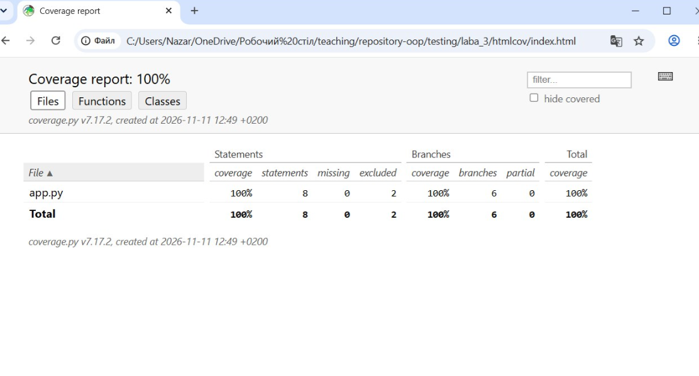
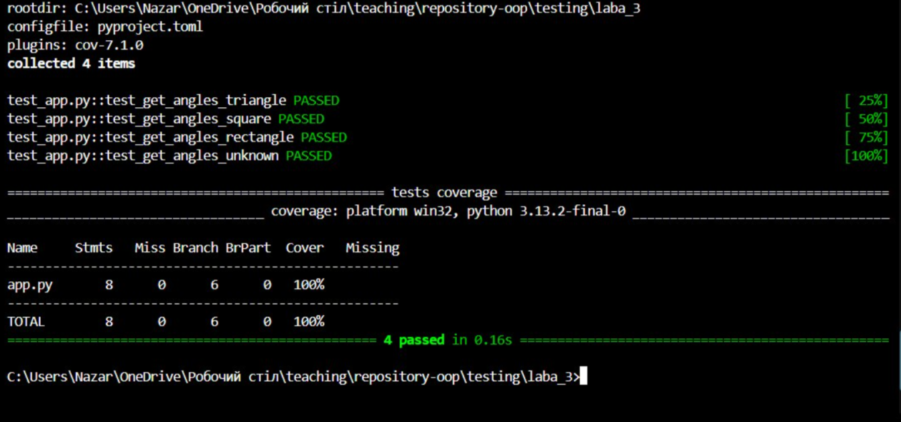

# Звіт до роботи

## Тема: Покриття коду тестами за допомогою coverage.py

### Мета роботи
Навчитись вимірювати покриття коду, знаходити неперевірені рядки та розгалуження, порівнювати результати pytest і unittest та створювати звіти coverage.

---

### Виконання роботи

#### 1. Запуск тестів і порівняння покриття

Для початкового вимірювання запустив лише тест трикутника:

```bash
python -m coverage erase
python -m coverage run -m pytest test_app.py -k triangle -v
python -m coverage report -m
```

Результат: `1 passed, 3 deselected`. Сукупне покриття рядків і гілок становило **29%**. Неперевіреними залишилися рядки 4, 5, 6, 7 і 9 — оброблення квадрата, прямокутника та невідомої фігури.

Після включення до запуску всіх чотирьох тестів повторив вимірювання:

```bash
python -m coverage erase
python -m coverage run -m pytest test_app.py -v
python -m coverage report -m
```

Результат:

```text
4 passed

Name     Stmts   Miss Branch BrPart  Cover   Missing
----------------------------------------------------
app.py       8      0      6      0   100%
----------------------------------------------------
TOTAL        8      0      6      0   100%
```

Покриття зросло з **29% до 100%**. Непокритих рядків і переходів не залишилося. Вимірювання виконувалося з увімкненим обліком розгалужень і виключенням тестових файлів.

#### 2. Різниця між покриттям рядків і розгалужень

**Покриття рядків** показує, чи виконувався кожен виконуваний рядок програми хоча б один раз.

**Покриття розгалужень** показує, чи перевірено всі можливі напрямки умовних переходів.

Наприклад, тест трикутника виконує першу гілку функції, але не перевіряє інші варіанти. За ввімкненого обліку розгалужень показник `Cover` враховує і рядки, і переходи.

#### 3. Окремий запуск unittest

Створив аналогічні перевірки для чотирьох випадків у `test_unittest.py` та запустив їх окремо:

```bash
python -m coverage erase
python -m coverage run -m unittest test_unittest -v
python -m coverage report -m
```

Результат:

```text
Ran 4 tests

OK
```

Обидва набори дали однаковий результат:

- pytest — **4 тести пройшли, покриття 100%**;
- unittest — **4 тести пройшли, покриття 100%**.

#### 4. Використання pragma: no cover

Для демонстраційної точки входу залишив виключення:

```python
if __name__ == "__main__":  # pragma: no cover
    print(get_angles("triangle"))
```

Під час тестування функція імпортується, тому цей блок не виконується. Без виключення сукупне покриття становило **89%**, а непокритим залишався рядок із `print`. Після повернення позначення результат становив **100%**.

Виключення не приховує логіку функції `get_angles`: усі її гілки перевіряються тестами.

#### 5. Створення HTML і XML-звітів

Виконав команди:

```bash
python -m coverage html
python -m coverage xml
```

Результат:

```text
Wrote HTML report to htmlcov/index.html
Wrote XML report to coverage.xml
```

**HTML-звіт** зручний для перегляду в браузері: він показує покриття файлів і підсвічує неперевірені рядки.

**XML-звіт** призначений для автоматичного опрацювання CI-системами та сервісами аналізу покриття.

#### 6. Результати виконання (скріншоти)


### Висновки

У ході роботи я навчився вимірювати покриття коду та аналізувати неперевірені ділянки. Повний набір тестів забезпечив 100% покриття функції як у pytest, так і в unittest. Також я перевірив використання `pragma: no cover` і створив HTML та XML-звіти. Високе покриття потрібно доповнювати перевірками правильності результатів.